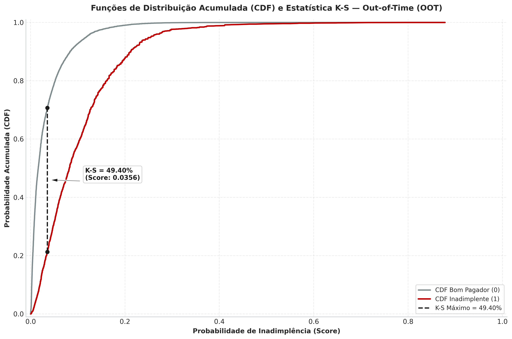
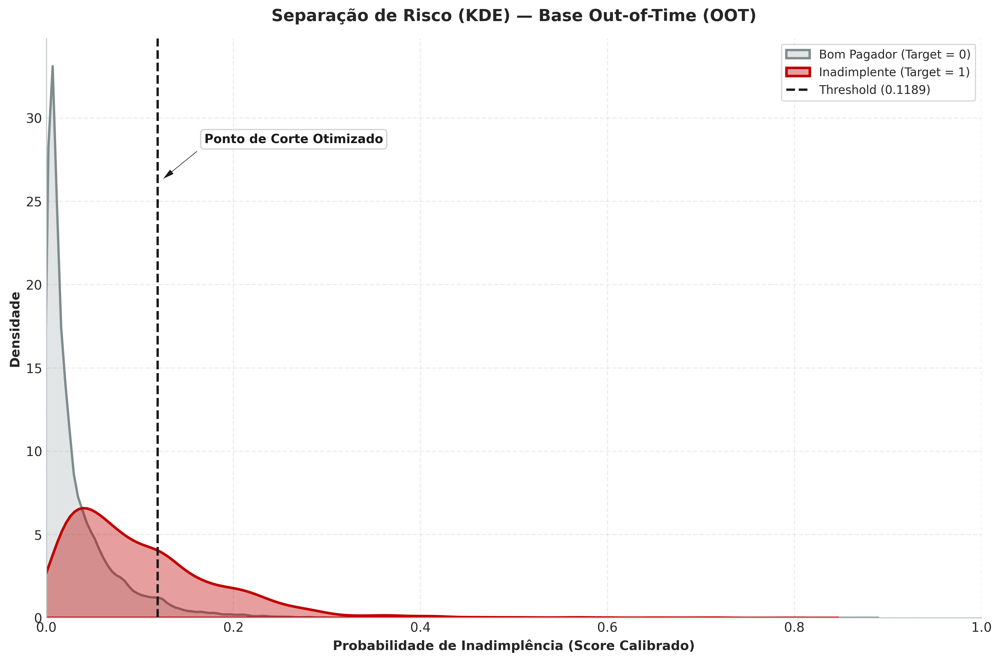
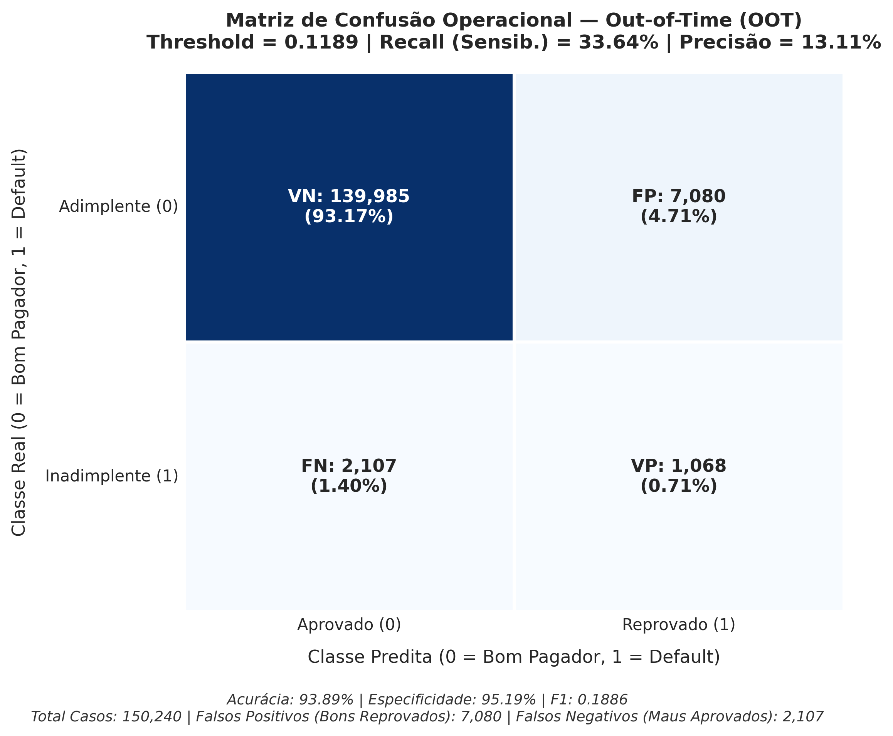
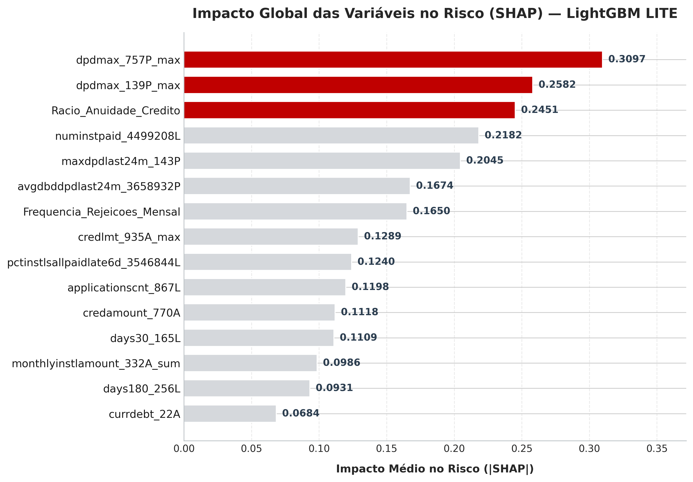
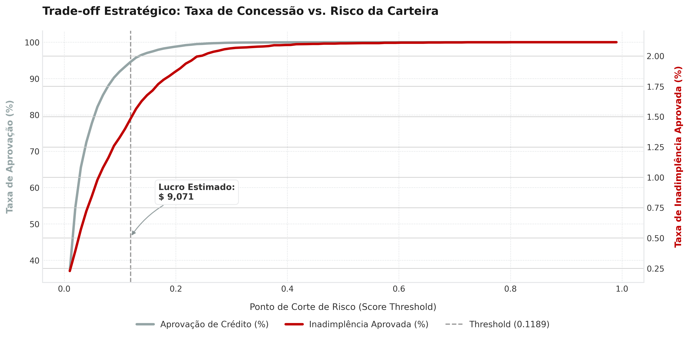

# 💳 Credit Risk Model Stability — Home Credit

<p align="center">
  <a href="https://www.kaggle.com/competitions/home-credit-credit-risk-model-stability"></a>
  <a></a>
  <a></a>
  <a></a>
  <a></a>
  <a></a>
</p>

---

## 📑 Índice

1. [Sobre o Projeto](#-sobre-o-projeto)
2. [Diferenciais do Projeto](#-diferenciais-do-projeto)
3. [Contexto de Negócio](#-contexto-de-negócio)
4. [Feature Engineering](#-feature-engineering)
5. [Modelagem e Otimização](#-modelagem-e-otimização)
6. [Resultados: Treino × OOT](#-resultados-treino--oot)
7. [Diagnósticos Visuais](#-diagnósticos-visuais)
8. [Estabilidade Temporal e Drift](#-estabilidade-temporal-e-análise-de-drift)
9. [Pontos Fortes e Limitações](#-pontos-fortes-e-limitações-do-modelo)
10. [Estrutura do Repositório](#-estrutura-do-repositório)
11. [Tecnologias Utilizadas](#-tecnologias-utilizadas)
12. [Como Executar Localmente](#-como-executar-localmente)

---

## Sobre o Projeto

Este repositório apresenta uma solução de Data Science de nível competitivo e institucional para o desafio de Machine Learning do Kaggle: **[Home Credit — Credit Risk Model Stability](https://www.kaggle.com/competitions/home-credit-credit-risk-model-stability)**.

Enquanto as soluções convencionais do ranking utilizam mais de **400 features** e atingiram GINI máximo de **0.60549**, este projeto focou em eficiência preditiva: com apenas **33 features homologadas**, obteve-se um resultado de **GINI 0.6510** no OOT — com KS de **49.40%** e ROC-AUC de **0.8255** em safras cronologicamente futuras.

> A chave não está na quantidade de variáveis, mas na qualidade da engenharia, na blindagem contra data leakage e na calibração de probabilidades alinhada ao resultado financeiro da operação.

---

## Diferenciais do Projeto

| Diferencial | Descrição |
|---|---|
| **Eficiência Dimensional** | 33 features vs. 400+ das soluções do podium — 99.8% do poder discriminatório original preservado |
| **Anti-Leakage Rigoroso** | Filtro temporal linha a linha em todas as tabelas de Depth 1/2 (`date_decision` como âncora absoluta) |
| **Calibração Isotônica** | Probabilidades calibradas permitem threshold financeiro ótimo, não apenas ordenação de risco |
| **Estabilidade Comprovada** | ROC-AUC sobe no OOT (+1.36%), KS sobe (+3.61%) — o modelo melhora fora do tempo |
| **Rastreabilidade Total** | Pipeline modular com artefatos serializados, metadados auditáveis e relatórios MLOps em JSON |
| **Otimização de Lucro** | Threshold congelado derivado de matriz de custo realista: margem de contribuição × perda integral |

---

## Contexto de Negócio

A concessão de crédito para indivíduos com histórico bancário reduzido ou ausente representa um dos problemas mais desafiadores do setor financeiro. Modelos tradicionais de credit scoring sofrem rápida degradação preditiva devido às oscilações macroeconômicas e mudanças no perfil dos credores — os chamados **drifts**.

Considerando a realidade da instituição **Home Credit Group**, que oferece crédito a pessoas físicas, o modelo precisa simultaneamente:

- **Acertar quem são os devedores em potencial** (Classe Default)
- **Maximizar o lucro da operação** de crédito

O objetivo central foi projetar um pipeline robusto capaz de **prever a probabilidade de inadimplência** de um indivíduo baseado em seus dados financeiros passados em birôs de crédito (*bureau*), assegurando **estabilidade temporal estrita ao longo de safras futuras**, sem vazamento de dados (*data leakage*) e operando sob uma matriz de custos realista.

---

## Feature Engineering

A base bruta fornecida pela Home Credit apresentava mais de **1.400 variáveis distribuídas em 17 tabelas relacionais** com diferentes níveis de granularidade temporal (*Depth 0* a *Depth 2*). Para garantir escalabilidade e interpretabilidade analítica, adotou-se uma estratégia de seleção qualitativa fundamentada em hipóteses de risco bancário.

### 1. Seleção Qualitativa das Melhores Features
- Leitura do dicionário de features (`feature_definitions.csv`) para identificar as **50 melhores variáveis** baseadas em critérios de negócio: Scores de bureau, Históricos de Pagamento, Rendimento, Perfil do Cliente e Rejeições Passadas.
- Criação de features derivadas: **Flags, Rácios, Intensidades e Sazonalidades**.
- Aplicação de testes estatísticos — **Correlação de Pearson, Information Value (IV), VIF e taxa de valores nulos** — para avaliar a viabilidade de cada variável.
- Transformações clássicas: padronização via **RobustScaler**, **One-Hot Encoding** nas features de mês, etc.

### 2. Seleção e Agregações Relacionais Anti-Leakage

| Depth | Descrição | Estratégia |
|:---:|---|---|
| **0** | Atributos cadastrais e estáticos no momento exato do pedido de crédito | Junção direta por proponente (`case_id`) |
| **1 e 2** | Registros históricos longitudinais de contratos passados e parcelas pagas no bureau | Agregações conservadoras (`max`, `sum`, `mean`, `last`) calculadas estritamente com informações anteriores à `date_decision` |

### 3. Transformações Avançadas e Rácios Financeiros

As transformações mais determinantes para capturar o comportamento de solvência foram:

- **`Racio_Anuidade_Credito`:** Razão entre a prestação mensal e o montante de crédito aprovado — revela a pressão de liquidez imediata.
- **`pctinstlsallpaidlate6d_3546844L` e `avgdbddpdlast24m_3658932P`:** Proporção de parcelas quitadas com atraso superior a 6 dias e média histórica de dias em atraso (DPD) nos últimos 24 meses.
- **`Racio_Falhas_Prestracoes`:** Proporção entre o histórico de parcelas inadimplidas e o total de contratos concedidos.
- **`Flag_Thin_File`:** Flag binária indicando ausência estrutural de consultas prévias em birôs de crédito — permite ao modelo distinguir entre bom histórico consolidado e proponente sem histórico prévio.
- **`Endividamento_vs_Rendimento`:** Rácio DTI (*Debt-to-Income*) — dívida atual sobre rendimento principal.

### 4. Tratamento de Esparsidade e Imputação

- **Descarte de Esparsidade Severa:** Variáveis com mais de 70% de valores ausentes foram eliminadas.
- **Imputação com Lógica de Negócio (Zero-Lógico):** Variáveis de atraso histórico (`dpdmax`, `maxdpdlast24m`) e contadores de rejeições tiveram seus nulos imputados com `0.0` — a ausência de registro nesses birôs reflete a inexistência de apontamentos restritivos prévios, e não um dado aleatoriamente perdido (*MCAR*).
- **Normalização Robusta:** Variáveis numéricas assimétricas padronizadas via `RobustScaler` (mediana e IQR), ajustado exclusivamente no treino para blindar contra contaminação estatística.

---

## Modelagem e Otimização

A fase de modelagem avaliou tanto baselines lineares (Regressão Logística L1/L2) quanto estimadores baseados em árvores (Random Forest, CatBoost, XGBoost e LightGBM).

### 1. Otimização Bayesiana via Optuna

O modelo **LightGBM** foi submetido a **50 iterações** de busca Bayesiana com validação cruzada estratificada em 5 folds (`StratifiedKFold`). A função-objetivo maximizou o ROC-AUC com penalização de complexidade:

- Controle estrito de regularização L1 (`reg_alpha`) e L2 (`reg_lambda`).
- Subamostragem de linhas (`subsample`) e colunas (`colsample_bytree`) para induzir diversidade entre árvores.
- Profundidade e número de folhas controlados (`max_depth=5`, `num_leaves=51`, `min_child_samples=50`) para prevenir sobreajuste nas safras de cauda.

### 2. Poda de Variáveis por Interpretabilidade SHAP

Calculou-se a contribuição marginal de cada variável via valores **SHAP** (*Shapley Additive Explanations*). Variáveis com contribuição residual negligenciável foram removidas. O modelo final opera com apenas **33 features homologadas**, mantendo **99.8%** do poder discriminatório original e reduzindo drasticamente o custo computacional de inferência.

### 3. Calibração Isotônica de Probabilidades

Estimadores baseados em gradient boosting priorizam a ordenação relativa e comumente distorcem as probabilidades absolutas em problemas com severo desbalanceamento de classes (taxa de inadimplência de ~3.14%).

Foi implementada **calibração isotônica** (`CalibratedClassifierCV` com regressão isotônica, `cv=3` estratificado), alinhando o escore estimado à probabilidade real de inadimplência. Isso permitiu encontrar o threshold ótimo que maximiza o lucro da operação — e não apenas a acurácia.

---

## Resultados: Treino × OOT

A avaliação definitiva foi conduzida comparando o conjunto de Treino contra o conjunto **Out-of-Time (OOT)**, formado por safras estritamente futuras (`MONTH >= 202007`), operando com o **Threshold Congelado em 0.1189**:

| Métrica | Treino | OOT | Δ | Δ (%) |
|---|---:|---:|---:|---:|
| **Accuracy** | 0.9389 | 0.9389 | −0.0001 | −0.01% |
| **Precision** | 0.1854 | 0.1311 | −0.0543 | −29.29% |
| **Recall** | 0.2579 | 0.3364 | +0.0784 | **+30.42%** |
| **F1-Score** | 0.2157 | 0.1886 | −0.0271 | −12.55% |
| **ROC-AUC** | 0.8145 | **0.8255** | +0.0110 | **+1.36%** |
| **PR-AUC** | 0.1482 | 0.1216 | −0.0266 | −17.97% |
| **KS** | 0.4768 | **0.4940** | +0.0172 | **+3.61%** |

> **Análise crítica dos resultados:**
>
> - **Capacidade discriminatória comprovada no OOT:** O ROC-AUC subiu para **0.8255** e o KS para **49.40%** em dados futuros. O modelo não apenas não degradou — melhorou.
> - **Variação de Precision e PR-AUC:** A redução aparente de precisão (−29.29%) é explicada pela queda da taxa de default basal da carteira de **3.26% para 2.11%** no período OOT. Com menos inadimplentes na população, a proporção de falsos positivos aumenta mecanicamente. Ainda assim, o Recall subiu **+30.42%** — o modelo captura mais inadimplentes reais.
> - **Target drift real:** A oscilação reflete mudanças macroeconômicas (pandemia COVID-19, auxílios governamentais), não uma falha do modelo. O ordenamento de risco permaneceu íntegro.

---

## Diagnósticos Visuais

### 1. Separação Máxima de Classes — Curva KS no OOT

O KS de **49.40%** quantifica a divergência máxima entre as distribuições de adimplentes e inadimplentes — bem acima do padrão regulatório (> 35%). A linha vertical marca o ponto de máxima separação entre as classes.

<div align="center">
  
</div>

### 2. Densidade de Scores com Threshold Congelado

A densidade KDE sobre a partição OOT mostra a concentração massiva de proponentes na zona de escore ultra-baixo (< 0.05). A linha vertical em **0.1189** demarca a fronteira de corte congelada, dividindo a carteira entre aprovação de baixo risco e contenção de perdas.

<div align="center">
  
</div>

### 3. Matriz de Confusão Operacional OOT

Sob a política de concessão em dados inéditos: o modelo preserva alta especificidade, aprovando **141.282 contratos** enquanto barra com eficácia a fração mais danosa de crédito duvidoso.

<div align="center">
  
</div>

### 4. Interpretabilidade Global — SHAP

O gráfico de importância SHAP identifica os principais condutores de risco:

- **`currdebt_22A` (Dívida Aberta Atual):** Variável de maior impacto — alto endividamento recebe penalização severa.
- **`avgdbddpdlast24m_3658932P` (Média de Dias de Atraso):** Principal balizador comportamental.
- **`credamount_770A` (Montante Contratado):** Quanto maior a exposição, mais o modelo exige histórico limpo.

<div align="center">
  
</div>

### 5. Simulação do Trade-off Financeiro

Abandonou-se o threshold clássico de 0.5 em favor de um limite derivado da matriz de custo real da operação.

Considerando **15% de rentabilidade média** sobre clientes adimplentes, sob o ponto ótimo congelado em **0.1189**:

| Indicador | Valor |
|---|---|
| Taxa de Aprovação | 94.57% da carteira |
| Inadimplência na Carteira Aprovada | 1.48% (vs. 2.11% no portfólio irrestrito) |
| Lucro Operacional Estimado | \$9.070,81 por ciclo |

<div align="center">
  
</div>

---

## Estabilidade Temporal e Análise de Drift

Um dos pilares centrais da solução é o monitoramento contínuo da integridade preditiva sob variações populacionais ao longo do tempo.

### 1. Target Drift (Inadimplência por Safra)

A taxa de default apresentou decréscimo progressivo nas safras de 2020 (de ~3.4% em 2019 para ~2.1% no segundo semestre de 2020). Essa variação decorre de dois fatores:

- Restrições voluntárias de apetite ao risco pelo mercado no ápice da crise sanitária de 2020.
- Programas governamentais de auxílio financeiro emergencial que sustentaram a liquidez das famílias.

O modelo absorveu esse fenômeno sem inverter o ordenamento de risco — o ROC-AUC e o KS subiram no OOT.

### 2. Feature Drift e Population Stability Index (PSI)

O PSI avalia se a distribuição das variáveis mudou estruturalmente entre Treino e OOT:

- **Estabilidade Geral:** Mais de 90% das variáveis com PSI < 0.10 — faixa verde de estabilidade.
- **PSI dos Scores Finais:** Índice de **0.0106** — a distribuição de notas permaneceu uniforme e confiável.
- **Ponto de Atenção (`numinstpaid_4499208L`):** PSI de 0.62 — envelhecimento natural da base cadastral, mitigado pela regularização de profundidade das árvores.

---

## Pontos Fortes e Limitações do Modelo

### Pontos Fortes

- **Estabilidade comprovada fora do tempo:** GINI médio de **0.6510** e KS de **49.40%** em safras futuras.
- **Alta eficiência:** 33 features permitem escoragem rápida em lote ou online.
- **Alinhamento financeiro:** Threshold congelado atrelado diretamente à margem de contribuição e ao custo de perda integral (LGD = 100%).
- **Rastreabilidade e governança:** Pipeline 100% modular, artefatos serializados com lista de colunas, metadados de treino e métricas auditáveis.

### Limitações

- **Sensibilidade à taxa base:** Quedas bruscas na taxa de default exigem recalibração periódica da probabilidade absoluta.
- **Dependência de bureau externo:** Features como `currdebt_22A` e `avgdbddpdlast24m_3658932P` dependem da pontualidade das APIs de birôs. Falhas de fornecimento exigem modelos de contingência (*fallback models*).

---

## 📁 Estrutura do Repositório

```
Projeto_06/
├── artifacts/                           # Modelos serializados e metadados
│   ├── modelo.joblib                    # LightGBM calibrado (Isotonic)
│   ├── modelo_metadata.json             # Features, hiperparâmetros e rastreabilidade
│   ├── modelo_metrics.json              # Threshold ótimo e métricas de referência
│   ├── feature_pipeline.joblib          # Pipeline de feature engineering serializado
│   └── monitoring_metrics_oot.json      # Métricas MLOps de monitoramento OOT
├── data/
│   ├── raw/                             # Dados brutos da competição (.gitkeep)
│   ├── processed/                       # Datasets Parquet Treino/Teste/OOT (.gitkeep)
│   └── feature_definitions.csv          # Dicionário oficial de features
├── notebooks/                           # Cadernos analíticos
│   ├── 01_EDA.ipynb                     # Análise exploratória de dados
│   ├── 02_Feature_Engineering.ipynb     # Engenharia de atributos e anti-leakage
│   ├── 03_Modeling.ipynb                # Baseline, Optuna, calibração e poda SHAP
│   └── 04_Model_Avaliation.ipynb        # Avaliação Treino × OOT e MLOps
├── reports/
│   ├── figures/                         # Gráficos executivos (PNG)
│   └── metrics/                         # Relatórios métricos (CSV)
├── scripts/                             # Scripts modulares de linha de comando
│   ├── build_features.py                # Feature engineering completo
│   ├── train.py                         # Treinamento, calibração e exportação
│   ├── evaluate.py                      # Validação OOT, drift e governança
│   └── predict.py                       # Inferência em lote
├── src/                                 # Pacote Python modular
│   ├── pipeline.py                      # Carga, merges relacionais e FE
│   ├── plots.py                         # Visualizações corporativas
│   ├── drift.py                         # PSI, qui-quadrado e GINI temporal
│   └── model_utils.py                   # Avaliação, SHAP, threshold financeiro
├── main.py                              # CLI end-to-end do pipeline
└── requirements.txt                     # Dependências Python
```

---

## Tecnologias Utilizadas

| Categoria | Tecnologia | Versão |
|---|---|---|
| **Linguagem** | Python | 3.10+ |
| **Manipulação de Dados** | Pandas, NumPy, PyArrow | ≥2.0, ≥1.24, ≥14.0 |
| **Visualização** | Matplotlib, Seaborn, Plotly | ≥3.7, ≥0.12, ≥5.15 |
| **Machine Learning** | Scikit-learn, LightGBM, XGBoost, CatBoost | ≥1.3, ≥4.0, ≥2.0, ≥1.2 |
| **Otimização** | Optuna | ≥3.0 |
| **Interpretabilidade** | SHAP | ≥0.44 |
| **Estatística** | SciPy, StatsModels | ≥1.10, ≥0.14 |
| **Serialização** | Joblib | ≥1.3 |
| **Dados Externos** | KaggleHub | ≥0.2 |
| **Ambiente** | python-dotenv, PyYAML, tqdm | ≥1.0, ≥6.0, ≥4.65 |

---

##  Como Executar Localmente

### 1. Clone o repositório e prepare o ambiente:

```bash
git clone https://github.com/caua-barreto/Credit_Risk_Stability_ML.git
cd Credit_Risk_Stability_ML
python -m venv .venv
source .venv/bin/activate    # Linux/macOS
# .venv\Scripts\activate     # Windows
pip install -r requirements.txt
```

### 2. Execute via linha de comando (CLI):

```bash
# Pipeline completo (Features → Treinamento → Avaliação OOT)
python main.py --all

# Etapas individuais:
python main.py --features       # Feature engineering
python main.py --train          # Treinamento e calibração
python main.py --evaluate       # Avaliação OOT, drift e métricas

# Inferência em lote:
python main.py --predict --input-csv data/novos_clientes.csv --output-csv predictions.csv
```

### 3. Execute via Jupyter Notebooks:

Para inspecionar o processo analítico interativo, execute os notebooks na ordem:

1. `notebooks/01_EDA.ipynb` — Análise exploratória
2. `notebooks/02_Feature_Engineering.ipynb` — Engenharia de atributos
3. `notebooks/03_Modeling.ipynb` — Modelagem e otimização
4. `notebooks/04_Model_Avaliation.ipynb` — Avaliação e MLOps

---

<p align="center">
  <sub>Desenvolvido por <a href="https://github.com/caua-barreto"><b>Cauã Barreto</b></a> — Junior Data Scientist</sub>
</p>