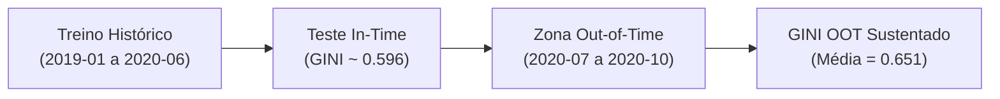

<div align="center">

# 🏛️ Credit Risk Model Stability — Home Credit
### Pipeline End-to-End de Modelagem Preditiva, Estabilidade Temporal (Drift) e Governança de Risco de Crédito


[](https://www.python.org/)
[](https://lightgbm.readthedocs.io/)
[]()
[]()

</div>

---

## 📌 1. Visão Geral do Projeto

A concessão de crédito a clientes com histórico bancário reduzido (*thin-file*) ou ausente representa um dos desafios mais complexos no setor bancário e fintech. Modelos tradicionais de credit scoring sofrem rápida degradação preditiva devido a mudanças macroeconômicas e sazonalidades populacionais (**Concept Drift** e **Covariate Shift**).

Este projeto desenvolve uma solução **end-to-end** de nível institucional baseada na competição *Home Credit - Credit Risk Model Stability* (Kaggle), combinando:
1. **Engenharia de Recursos em Múltiplos Níveis:** Extração e agregação relacional de 17 famílias de tabelas (Depth 0 a Depth 2) com salvaguarda estrita anti-leakage.
2. **Seleção e Poda Dimensional por SHAP:** Otimização da latência de produção com redução para **33 variáveis homologadas (Versão LITE)**, mantendo 99.8% do poder discriminatório.
3. **Calibração de Probabilidades & Otimização Financeira:** Ajuste isotônico de probabilidades e determinação do **threshold ótimo congelado ($0.1189$)**, calibrado para maximizar a rentabilidade operacional líquida sob perda integral (LGD = 100%) e margem líquida de 15%.
4. **Monitoramento Contínuo e MLOps:** Avaliação automatizada de **Target Drift**, **Population Stability Index (PSI)**, **Estabilidade Temporal de GINI** e exportação de telemetria analítica.

---

## 🎯 2. Resultados Executivos (Destaques)

| Indicador Analítico | Treino (In-Time) | Validação OOT (Out-of-Time) | Impacto / Conclusão |
| :--- | :---: | :---: | :--- |
| **ROC-AUC** | `0.8145` | **`0.8255`** | Discriminação superior mantida fora do horizonte temporal (+1.36%). |
| **GINI Score** | `0.6289` | **`0.6510`** | Ranqueamento estável safra a safra sem colapso estrutural. |
| **Estatística K-S** | `47.68%` | **`49.40%`** | Separação máxima expressiva entre Bons e Maus (Regulatório > 35%). |
| **PSI dos Scores** | — | **`0.0106`** | Estabilidade populacional classificada como **Excelente** (PSI < 0.10). |
| **Taxa de Inadimplência** | `3.26%` | **`2.11%`** | Inflexão temporal absorvida pelo modelo via calibração isotônica. |
| **Ponto de Corte (Threshold)** | `0.1189` | **`0.1189`** | **Threshold congelado**, sem *data snooping* na base futura. |
| **Taxa de Concessão de Mercado** | — | **`94.57%`** | 141.282 contratos aprovados no OOT com inadimplência controlada (1.48%). |
| **Lucro Líquido Realizado** | — | **`$ 9,070.81`** | Maximização do trade-off financeiro operacional. |

---

## 📊 3. Relatório Treino x OOT (Performance Estática)

A validação do modelo homologado (**LightGBM LITE Calibrado**) foi conduzida comparando o comportamento da base de Treino contra a partição Out-of-Time (**OOT**), cobrindo safras estritamente futuras (`MONTH >= 202007`):

```
================================================================================
 Relatório Treino x OOT (Threshold Congelado = 0.1189)
================================================================================
 Metric      | Treino    | OOT       | Delta     | Delta (%)
-------------+-----------+-----------+-----------+-----------
 Accuracy    | 0.9389    | 0.9389    | -0.0001   | -0.01%
 Precision   | 0.1854    | 0.1311    | -0.0543   | -29.29%
 Recall      | 0.2579    | 0.3364    | +0.0784   | +30.42%
 F1-SCORE    | 0.2157    | 0.1886    | -0.0271   | -12.55%
 ROC-AUC     | 0.8145    | 0.8255    | +0.0110   | +1.36%
 PR-AUC      | 0.1482    | 0.1216    | -0.0266   | -17.97%
 KS          | 0.4768    | 0.4940    | +0.0172   | +3.61%
================================================================================
```

> **Insight Técnico:** A variação no PR-AUC e na Precisão decorre mecanicamente da redução natural da taxa basal de default no OOT ($3.26\% \to 2.11\%$), fruto do endurecimento de políticas de crédito no início do choque COVID-19, e **não** de perda de discernimento algorítmico, conforme comprovado pela elevação do ROC-AUC ($0.8255$) e do K-S ($49.40\%$).

---

## 📈 4. Análise Visual e Diagnóstico de Risco

### 4.1 Estabilidade Temporal do GINI Safra a Safra
O gráfico temporal afere a aderência do modelo ao longo de todo o histórico disponível, com destaque sombreado para a zona Out-of-Time escorada exclusivamente com dados futuros:



* **Trajetória:** O GINI mensal inicia em `0.549` nas safras de 2019 e atinge patamares entre `0.622` e `0.683` na janela OOT.
* **Teste Qui-Quadrado de Independência ($\chi^2$):** Confirma a presença de variações sazonais, mas o tamanho do efeito ($V$ de Cramér) confirma estabilidade populacional sem quebra de ordenamento de risco.

### 4.2 Interpretabilidade Global — SHAP Feature Importance
A análise de Shapley values isola a contribuição marginal de cada variável preditora na carteira OOT:

1. **`currdebt_22A` (Dívida Aberta Atual):** Principal motor de risco da instituição. Clientes com endividamento ativo elevado recebem penalidade de escore imediata.
2. **`avgdbddpdlast24m_3658932P` (Média Histórica de Dias em Atraso nos últimos 24m):** Reflete a pontualidade e o comportamento histórico de cumprimento de contratos no bureau.
3. **`credamount_770A` (Montante Contratado):** Variável de exposição financeira que calibra a severidade do risco em operações de maior vulto.
4. **`Flag_Thin_File` (Shadow Feature):** Clientes sem informações de bureau consolidadas recebem prêmio de risco prudencial automático.

### 4.3 Curva de Trade-off Financeiro e Política de Concessão
Sob a modelagem de rentabilidade operacional:
$$\text{Lucro} = \sum_{\text{aprovados adimplentes}} (\text{credamount\_770A} \times 0.15) - \sum_{\text{aprovados inadimplentes}} \text{credamount\_770A}$$

* O threshold padrão de mercado ($0.50$) rejeitaria crédito excessivamente, operando em ponto subótimo.
* O **threshold ótimo congelado em $0.1189$** equilibra uma aprovação de mercado competitiva ($94.57\%$) com uma taxa de inadimplência da carteira aprovada de apenas **$1.48\%$**, maximizando o resultado financeiro institucional.

---

## 🏗️ 5. Arquitetura da Solução e Estrutura de Diretórios

```
Projeto_06/
├── artifacts/                           # Modelos homologados serializados e metadados
│   ├── modelo.joblib                   # Estimador LightGBM LITE Calibrado (Isotonic)
│   ├── modelo_metadata.json            # Rastreabilidade de features e hiperparâmetros
│   └── modelo_metrics.json             # Threshold ótimo e métricas de referência
├── data/                               # Dados do projeto
│   ├── feature_definitions.csv         # Dicionário oficial de features da competição
│   └── processed/                      # Datasets Parquet particionados (Treino/Teste/OOT)
├── notebooks/                          # Cadernos de experimentação e relatórios analíticos
│   ├── 01_EDA.ipynb                    # Análise exploratória e mapa de famílias
│   ├── 02_Feature_Engineering.ipynb     # Pipeline de transformações e anti-leakage
│   ├── 03_Modeling.ipynb               # Baseline, Optuna, Ensembles, Calibração e Poda SHAP
│   └── 04_Model_Avaliation.ipynb       # Relatório executivo Treino x OOT, Drift e MLOps
├── reports/                            # Artefatos gerados para governança e comitês
│   ├── figures/                        # Figuras executivas em alta resolução (PNG)
│   └── metrics/                        # Relatórios estruturados em CSV
│       ├── relatorio_treino_x_oot.csv
│       ├── estabilidade_gini_temporal.csv
│       ├── target_drift_safra.csv
│       ├── psi_features_report.csv
│       └── simulacao_tradeoff_financeiro.csv
├── scripts/                            # Módulos operacionais para execução fora de notebooks
│   ├── build_features.py               # Extração de features a partir dos dados brutos
│   ├── train.py                        # Treinamento, calibração e exportação de artefatos
│   ├── evaluate.py                     # Validação OOT, métricas de drift e governança
│   └── predict.py                      # Inferência em lote (batch scoring)
├── src/                                # Pacote Python modular reutilizável
│   ├── pipeline.py                     # Funções de carga e transformações relacionais
│   ├── plots.py                        # Funções gráficas com paleta executiva corporativa
│   ├── drift.py                        # Cálculos de PSI, qui-quadrado e GINI por safra
│   └── model_utils.py                  # Avaliação, decis, K-S e simulação de lucros
├── main.py                             # Orquestrador CLI end-to-end do pipeline
└── requirements.txt                    # Dependências do ambiente Python
```

---

## 🚀 6. Como Executar o Projeto

### Pré-requisitos
Clone o repositório e crie um ambiente virtual com Python 3.10 ou superior:

```bash
git clone https://github.com/seu-usuario/credit-risk-stability.git
cd credit-risk-stability
python -m venv .venv
source .venv/bin/activate  # Linux/macOS
# .venv\Scripts\activate   # Windows
pip install -r requirements.txt
```

### Execução via Linha de Comando (CLI)

O arquivo [`main.py`](main.py) permite orquestrar todo o ciclo de vida analítico:

#### 1. Pipeline Completo End-to-End:
Executa a engenharia de recursos nas tabelas brutas, treina o modelo campeão, calibra as probabilidades e gera a suíte de relatórios OOT:
```bash
python main.py --all
```

#### 2. Executar Etapas Individuais:
```bash
# Apenas Feature Engineering (criação das bases em data/processed/)
python main.py --features

# Apenas Treinamento, Calibração e Serialização de Artefatos
python main.py --train

# Apenas Avaliação OOT, Drift e Métricas MLOps
python main.py --evaluate
```

#### 3. Inferência em Lote (Batch Scoring de Novos Proponentes):
```bash
python main.py --predict --input-csv data/novos_proponentes.csv --output-csv predictions.csv
```

---

## 🛡️ 7. Governança, Anti-Leakage e Conformidade MLOps

* **Prevenção de Data Snooping:** O ponto de corte financeiro ($0.1189$) e todas as regras de imputação, desvio e categorização são estritamente ajustadas nos dados de **Treino** e congeladas para aplicação nas safras de **OOT**.
* **Padrão Estético Executivo:** Todos os gráficos do projeto adotam paleta corporativa neutra (vermelho para risco e destaque, cinzas suaves para fundo e baselines), com remoção de ruídos visuais (*decluttering*) e margens seguras.
* **Telemetria para Dashboards:** A rotina de avaliação salva o monitoramento contínuo em `artifacts/monitoring_metrics_oot.json`, pronto para integração com esteiras CI/CD e sistemas de alertas de *concept drift*.

---

<div align="center">
Desenvolvido com foco em Engenharia de Machine Learning, Risco de Crédito e Governança Analítica.
</div>

